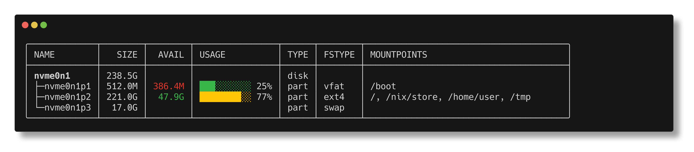

# Jai List BLocK devices

> [!NOTE]
>
> This is (hopefully temp) developed with open-jai, and relies on vibe-coded
> `open-jai-linux.patch` and build script in `flake.nix`



## Run

Run it from GitHub using Nix:

```bash
# https
nix run github:ethanthoma/jlsblk

# ssh
nix run git+ssh://git@github.com/ethanthoma/jlsblk.git
```

Or clone and run it locally using the Nix flake's dev shell:

```bash
# run with nix
nix run

# run using the bash script
nix develop
./run
```

## Usage

There are four color modes:

```bash
jlsblk --color auto # true color, turns off color when piped

jlsblk --color true # true color

jlsblk --color ansi # uses terminal set colors

jlsblk --color none # no color
```

## Install

NixOS config:

```nix
  {
    inputs.jlsblk.url = "github:ethanthoma/jlsblk";

    environment.systemPackages = [ inputs.jlsblk.packages.${pkgs.system}.default ];
  }
```

## Links

- https://github.com/Ivo-Balbaert/The_Way_to_Jai
- https://github.com/peteretelej/tree
- https://github.com/withlang-dev/open-jai
